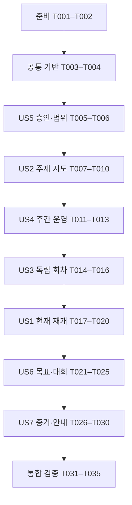

# 작업 목록: 주제와 난도에 따른 알고리즘 학습 체계 개편

**입력**: [명세](spec.md), [계획](plan.md), [연구](research.md), [개념 모델](data-model.md), [회차 계약](contracts/learning-session.md), [기록 계약](contracts/document-records.md), [검증 가이드](quickstart.md).

**공식 실행**: `1d02e086`. 작업 분해 시 `review-spec`·`review-plan` 완료와 현재 `tasks` 단계를 확인했다. 승인 기록은 spec·plan에 있으며 중복 승인을 요구하지 않는다. 실제 Git 브랜치는 `main`이다. 새 workflow 실행·브랜치·커밋·push·제출·배포를 만들지 않는다.

**상태**: T001–T035 모두 수행·검증 후 완료 표시했다. 2026-10-19 KST 종료 후 공식 Run의 여섯 단계가 모두 `completed`임을 확인했다. 목록 생성·문서 시나리오 검토·실제 운영 문서 반영·사용자의 4주 시범 수행은 서로 다른 결과이며 실제 시범은 아직 시작하지 않았다.

**구성**: P1 이야기 안에서는 승인·기준 문서·회차 절차를 먼저 정리하고 현재 재개점을 반영하도록 US5 → US2 → US4 → US3 → US1 순서로 배치한다. 이후 P2인 US6 → US7을 적용하고 통합 검증한다. 이야기 번호는 spec.md의 번호를 유지한다.

## 형식과 경로

- 작업 형식은 `- [ ] T번호 [P 선택] [US번호] 설명과 파일 경로`다. 준비·공통 기반·마무리 작업에는 US 라벨을 붙이지 않는다.
- `[P]`는 선행 작업 완료 후 서로 다른 파일에서 독립적으로 수행할 수 있는 작업이다. 같은 파일의 편집은 한 작성자가 순서대로 맡는다. 병렬 예시는 실행 가능성의 설명이며 새 에이전트를 자동 생성하라는 지시가 아니다.
- 모든 파일 경로는 저장소 루트 기준이다. 이 문서의 Markdown 링크만 문서 기준 상대경로다.
- 운영 변경 대상은 `ROADMAP.md`, `STATE.md`, `docs/REFERENCES.md`, `README.md`, `.agents/skills/study-algorithms/SKILL.md`, `.agents/skills/review-algorithm-contest/SKILL.md`, `contests/README.md`, `contests/template.md`의 여덟 파일이다. 구현·검증 기록은 `specs/001-redesign-learning-system/quickstart.md`, 작업 완료 표시는 이 `tasks.md`에 둔다.
- 개념 모델은 기존 본문의 의미다. 새 필수 frontmatter·DB·자동 상태 전이·세션별 진도 파일을 만들거나 기존 노트를 일괄 변환하지 않는다. 모르는 값은 `미확인` 또는 기존 형식의 `unknown`으로 둔다.
- 새 자동 테스트·상시 검사기는 추가하지 않는다. spec의 인수 시나리오와 기존 검사만 사용하며 검토 예시를 실제 사용자 경험으로 저장하지 않는다.

## Phase 1: 준비

**목적**: 현재 공식 단계와 사용자 변경을 확인하고 이후 보존 검증의 기준을 확보한다.

- [X] T001 `AGENTS.md`, `specs/001-redesign-learning-system/spec.md`, `specs/001-redesign-learning-system/plan.md`와 공식 `bash scripts/speckit-workflow.sh status 1d02e086`를 대조해 기존 승인·현재 단계·실제 main을 확인하고, `.specify/extensions.yml` 존재 시 현재 명령의 훅 규칙도 확인하여 준비 결과를 `specs/001-redesign-learning-system/quickstart.md`에 기록한다. 이미 실행 중인 Run을 새로 run/resume하지 않는다.
- [X] T002 쓰기 전 status/diff와 기존 파일을 읽고 운영 대상 여덟 파일·기존 노트/풀이·`.vscode/tasks.json`·`tests/test_companion_router.py`·`.specify/memory/constitution.md`·존재하는 `main.py`·`ex.in`·`.cph` 파일의 상대경로와 SHA-256을 버전 관리 밖 임시 매니페스트에 확보한다. 사용자 선행 변경과 실제 존재 범위만 `specs/001-redesign-learning-system/quickstart.md`에 요약하며 scratch를 실행·수정하지 않는다.

## Phase 2: 공통 기반

**목적**: 모든 이야기에서 사용할 문서 책임과 호환성 경계를 고정한다. T001–T004가 끝난 뒤 이야기 작업을 시작한다.

- [X] T003 `specs/001-redesign-learning-system/contracts/document-records.md`와 `specs/001-redesign-learning-system/plan.md`를 기준으로 ROADMAP=범위/운영, STATE=현재 위치/다음 한 행동, REFERENCES=출처, 학습 스킬=회차, 기록 스킬=요청한 경험 저장의 반영 위치를 `specs/001-redesign-learning-system/quickstart.md`에 정리한다. 여덟 운영 파일 밖의 기존 코드·노트·도구·환경·lockfile·웹 변경을 작업 범위에 추가하지 않는다.
- [X] T004 `knowledge/template.md`, `templates/problem-note.md`, `contests/template.md`, `scripts/validate_notes.py`와 기존 기록 스킬을 읽어 `title/updated/tags`, 문제의 `url/solution`, 대회의 `url` 및 필수 본문·플랫폼 경로·LeetCode API를 유지할 기준을 `specs/001-redesign-learning-system/quickstart.md`에 남긴다. `.agents/skills/study-algorithms/SKILL.md#종료와-다음-세션` 등 기존 수신 링크와 유지할 문서 앵커를 확인하며 새 스키마를 도입하지 않는다.

**확인점**: 사용자 선행 변경·보존 대상·공식 승인·문서별 책임을 찾을 수 있다. 아직 사용자 학습 결과를 생성하지 않았다.

## Phase 3: US5 — 검토 승인과 단계 경계 유지 (P1)

**목표**: 이미 받은 승인을 존중하면서 명세·계획·구현·학습 수행을 구분한다.

**독립 검증**: Run의 완료된 두 검토 게이트, 미비준 헌법, 현재 변경 목록만으로 V09·SC-008을 검토한다. 품질 검사 결과를 승인으로 대체하지 않고, 추가 승인 대기나 원격 작업을 만들지 않는다.

- [X] T005 [US5] `specs/001-redesign-learning-system/quickstart.md`의 현재 전제와 V09 기대 결과를 명세·계획 승인 후 구현 검증에 맞게 갱신하고 기존 `이번 계획 단계의 실행 기록`은 날짜가 있는 과거 기록으로 보존한다. `specs/001-redesign-learning-system/spec.md`·`specs/001-redesign-learning-system/plan.md`의 기존 승인 근거를 연결하고 사용자가 새로 승인했다고 꾸미지 않는다. (FR-024)
- [X] T006 [US5] `.specify/memory/constitution.md`가 미비준 placeholder임을 다시 확인하고 실제 `AGENTS.md`·학습 스킬·승인 명세를 적용 근거로 `specs/001-redesign-learning-system/quickstart.md`에 명시한다. 새 앱·대시보드·DB·수집기·커밋·push·온라인 제출·배포가 범위 밖임을 변경 목록과 대조한다. (FR-023, FR-025, FR-026)

**확인점**: 승인 사실과 실제 구현 상태가 분리되어 있고 다음 단계에 불필요한 재승인이 없다.

## Phase 4: US2 — 주제 선택과 관찰 가능한 난도 전환 (P1)

**목표**: T01–T13의 유한한 지도에서 필요한 선수만 연결하고 주제 안의 난도를 올리거나 다른 주제로 이동한다.

**독립 검증**: V03·SC-002에 따라 DP·그래프 구조·합성곱 세 주제의 진입·다음 변형·재방문을 설명하고, 상향·보완·이동 사례를 적용한다. 지도 존재를 학습 완료로 해석하지 않는다.

- [X] T007 [P] [US2] `specs/001-redesign-learning-system/research.md` R03·R04·R06과 `specs/001-redesign-learning-system/research-evidence.md`의 확인된 출처를 `docs/REFERENCES.md`에 반영한다. USACO Guide의 비고정 실라버스·모듈 간 난도 비비교·제한된 Python 지원, CSES 대표 구현, DP A–Z 26개 패턴 선별, Typical 90 제작자·90문제·별 1–7의 컬렉션 내부 의미, cp-algorithms 심화 참고를 구분하고 번호순 완주·별/rating 환산·유일한 해설 타이머를 권하지 않는다. 기존 도구 참고와 과거 확인일은 보존하고 새로 조회하지 않은 내용을 이번 구현에서 재확인했다고 쓰지 않는다. (FR-005, FR-006)
- [X] T008 [P] [US2] `ROADMAP.md`의 기존 묶음을 승인 명세의 T01–T13 전체로 개편해 탐색/배열·완전탐색/구현·그리디/정당성·DP·그래프 구조·경로/연결 비용·매칭/유량·자료구조/트리·문자열·수학/확률/게임·기하·오프라인/분할정복/최적화·다항식/합성곱을 담는다. 개념 모델의 제약 “명세의 T01–T13. 하위 기법과 기본/응용/선택 심화를 구분한다.”, “해당 주제 안의 기초·응용·심화. 서로 다른 주제의 동일 단계는 절대 난도가 아니다.”, “현재 과제에 필요한 개념·구현. 관계없는 주제의 완주를 추가하지 않는다.”를 그대로 적용한다. (FR-005, FR-006)
- [X] T009 [US2] `ROADMAP.md`에 각 주제의 진입 근거·다음 변형·재방문 단서를 회차 계약의 주제별 표와 연결하고 공통 상향/보완/이동 기준을 한 곳에 둔다. 제약 “현재 코드·설명·실제 결과 또는 필요한 최초 설명. 과거 이력의 재답변을 강제하지 않는다.”, “유지·상향·선수 보완·다른 주제 이동·선택 심화 보류. 이유와 근거를 연결한다.”, “다른 날 재현, 새 문제 적용, 관찰한 반복 오류, 다음 응용에서 필요한 선수 중 하나 이상.”을 적용한다. 서로 다른 대표 변형 두 개의 추가 핵심 힌트 없는 근거로 잠정 상향하고, 새 핵심 단계 둘 이상 또는 같은 공백 두 시도 반복 시 보완하며, 다음 선수가 준비되면 선택 심화 완주 없이 이동하도록 명시한다. 같은 문제 재실행 두 번은 두 변형이 아니며 다른 날 재현·새 문제 독립 적용 전 장기 숙달로 쓰지 않는다. (FR-007, FR-008, FR-009)
- [X] T010 [US2] 개편한 `ROADMAP.md`를 `specs/001-redesign-learning-system/quickstart.md` V03으로 검토해 T01–T13 누락 여부와 세 주제의 진입/상향/보완/이동/재방문 선택 근거를 기록한다. DP → SCC → 이분탐색 선택과 FFT 진입에 무관한 유량 완주를 요구하지 않는 사례를 포함하고 문서 검토를 사용자 숙달 기록으로 남기지 않는다. (SC-002)

**확인점**: 학습 주제를 선택해 필요한 과제만 고를 수 있고 전체 주제를 단일 절대 난도로 줄 세우지 않는다.

## Phase 5: US4 — 주 5–7시간 운영과 4주 재조정 (P1)

**목표**: 대회·복기·기록을 합계에 포함하고 독립 작업을 충분히 배정한다.

**독립 검증**: V05·V06·SC-004·SC-005로 일반/대회 주의 여섯 합계와 독립 하한을 계산한다. 이월·휴식·미측정·5시간 미만 예외 주에서도 다음 주에 과제를 빚으로 쌓지 않는다.

- [X] T011 [US4] `ROADMAP.md`의 기존 9–13시간·최대 15시간 운영을 회차 계약의 일반/ABC 대회 주 5·6·7시간 예시로 교체한다. 예산 제약 “가용 300/360/420분, 일반/대회 주, 활동별 전체 배정과 그 안의 독립 작업 배정”을 적용하고 여섯 행을 각각 300·360·420분으로 맞춘다. 대회·복기·기록은 기존 활동을 대체하며 100분과 다른 대회에는 공식 시간을 반영해 다른 활동을 줄인다. (FR-014, FR-015)
- [X] T012 [US4] `ROADMAP.md`에 회차 계약의 활동 안 독립 작업 표를 함께 반영하고 제약 “사용자가 직접 설계·구현·실행·반례를 검토하는 시간. 설명·AI 코드 작성 시간과 중복 계산하지 않는다.”를 명시한다. 독립 합계 175/220/260분 및 ABC 주 195/235/275분을 활동 전체와 별도로 더하지 않고 각 활동 이하·주간 절반 이상인지 확인한다. 배정 시간을 실제 시간이나 도움 없는 해결 성과로 취급하지 않는다. (FR-012, SC-003, SC-004)
- [X] T013 [US4] `ROADMAP.md`에 실제 첫 학습일부터 계산하는 SCC→DAG DP 연결·DP 응용·이분탐색 응용·태그 없는 혼합/운영 검토의 4주 예시와 이후 4주 조정을 추가한다. 제약 “이번 주 안의 배정 시간. 과제 하나가 여러 회차·주에 이어질 수 있다.”, “관찰하거나 사용자가 보고한 값·근사 여부·미측정. 계획값을 복사해 실적으로 만들지 않는다.”, “남은 작업과 다음 주에 줄일 신규 범위. 주 7시간 초과의 의무 분량을 만들지 않는다.”, “실제 시간·도움·반복 오류·다른 날 재현 또는 미확인을 근거로 유지·축소·상향을 선택한다.”를 적용한다. 격주 측정 기회·첫 4주 내 측정 기회는 선택지로 두고 불참·이월·휴식·5시간 미만 예외를 허용하며 rating/올솔을 4주 성과로 보장하지 않는다. (FR-016)

**확인점**: 여섯 예산에 숨은 추가 활동이 없고 실제 미완료를 유지하면서 신규 범위를 줄일 수 있다.

## Phase 6: US3 — 충분한 독립 작업과 필요한 도움 (P1)

**목표**: 신규 기법에는 설명을 제공하고 이후 설계·구현·실행·반례 검토를 학습자에게 맡긴다.

**독립 검증**: V04·SC-003의 신규 기법·익숙한 주제·혼합 문제·힌트 요청 네 상황에서 과제 하나와 도움 경계를 설명한다. 연속 한 줄 퀴즈·자동 정답 공개·미요청 코드 교체가 없다.

- [X] T014 [US3] `.agents/skills/study-algorithms/SKILL.md`의 회차 시작을 개념 모델의 “이번 작업에서 확인할 목표 하나, 지금 선택한 이유, 완료 기준.”, “새 기법 학습·주제별 재현·혼합 연습·대회/측정. 방식에 따라 사전 기법 공개와 도움 경계가 달라진다.”에 맞춘다. 새 기법에는 목적·원리·작은 예제·적용 조건을 설명하고 백지 구현/실행은 사용자에게 맡기며, 익숙한 주제·혼합은 독립 시도부터 시작하고 혼합의 태그·접근법을 숨긴다. (FR-010, FR-011)
- [X] T015 [US3] `.agents/skills/study-algorithms/SKILL.md`에 실제 막힘에 따른 관찰/반례 → 부분 설명 → 핵심 아이디어 → 요청 시 해설·코드의 도움 경계를 맞춘다. 독립 탐색을 고정 타이머로 끝내거나 매번 한 줄 질문으로 나누지 않고 필요한 도움 뒤 전체 과제로 복귀한다. 코드 제공/수정·입출력 준비 요청의 범위를 지키고 난도 전환·예산은 `ROADMAP.md`의 기준에 연결해 표를 복제하지 않는다. (FR-012, FR-013)
- [X] T016 [US3] `.agents/skills/study-algorithms/SKILL.md`에 `종료와 다음 세션` 제목을 복원하고 기존 기록 스킬의 수신 앵커를 살린다. 종료는 결과·남은 질문·다음 행동의 대화 정리로 두고 저장·STATE 갱신은 현재 요청/기존 승인 범위에서만 수행하며 정리·복기 요청은 기존 해당 스킬로 연결한다. 실전·측정용 virtual 중 AI 풀이/디버깅은 종료 후 복기로 돌리고 도움 받은 virtual은 일반 연습으로 구분한다. (FR-019, FR-021, FR-022)

**확인점**: 기존 근거를 활용하는 충분한 과제와 단계적 도움이 작동하고 사용자 풀이의 소유권이 유지된다.

## Phase 7: US1 — 실제 현재 위치에서 재개 (P1, 첫 기능 확인점)

**목표**: 최신 확인 스냅샷·현재 코드·남은 DAG DP에서 다음 행동 하나를 고른다.

**독립 검증**: V01·V02·SC-001에서 오래된 STATE, 현재 scratch, scratch 부재의 세 경우를 검토한다. 다른 주제나 대회 수행 없이 다음 과제·이유·완료 기준과 미확인을 설명하고 SCC 재시작·Coin Collector 완료 오기를 피한다.

- [X] T017 [P] [US1] `docs/REFERENCES.md`에 `specs/001-redesign-learning-system/research-evidence.md`의 2026-10-19 기준 계정 근거와 공식/비공식 출처를 연결한다. 1065 provisional·rated 9회·ABC480·performance 1532, 최근 5회 1197/1228/1272/1505/1532와 평균 1346.8·중앙값 1272의 상세 기준 위치를 안내하고 공식 프로필/history와 비공식 시간 내 A–E AC·공식 제출/standings HTTP 429 한계를 구분한다. 누적 AC 시각을 순수 사고 시간으로 쓰지 않고 F/G 열람·시도·도움 및 Codeforces 현재 기준선은 미확인으로 둔다. (FR-001, FR-003)
- [X] T018 [P] [US1] `main.py`·`cses/Planets_and_Kingdoms.py`를 읽기만 하여 현재 SCC/축약 구현과 미구현 `max_coins`를 재확인하고 `git show 7c5bf71e96e2fefd3451178470662554d209232e:STATE.md`를 작업 전 `STATE.md`와 대조한다. 일치 여부와 현재 남은 범위를 `specs/001-redesign-learning-system/quickstart.md`에 기록한다. 불일치하면 현재 추가 기록도 보존할 방법을 먼저 정하고 revision으로 대체하지 않으며 scratch가 없으면 공유 가능한 기존 SCC 코드에서 이어간다. (FR-002, FR-023)
- [X] T019 [US1] T017·T018 뒤 `STATE.md`를 확인일·분리된 목표/5–7시간 운영 링크·최신 계정 근거 요약·현재 SCC/축약 구현·남은 값 집계/DAG DP·보류한 세그먼트 트리 질문 링크·다음 독립 행동 하나로 축약한다. 과제 제약 “이미 구현한 부분, 남은 설계·구현·검증, 실제로 막힌 위치.”를 적용해 목표/이유/완료 기준을 짧게 둔다. 과거 972·ABC478 및 상세 관찰은 날짜가 고정된 revision과 `knowledge/data-structures/segment-tree.md`로 보존하고 추적되는 SCC 코드만 링크한다. `main.py`·`ex.in` 상대 링크나 `solution`을 만들지 않고 SCC 입문 관문·Coin Collector 완료/AC·다른 날 독립 재현을 새로 주장하지 않는다. (FR-001, FR-002, FR-022, FR-023)
- [X] T020 [US1] `.agents/skills/study-algorithms/SKILL.md`의 재개/문제 선택을 현재 코드·설명 우선으로 맞추고 제약 “실제 문제 URL·기존 코드·노트. 공유 노트의 코드 링크는 추적되는 플랫폼 풀이를 사용한다.”, “미견 확인·기출/해설 노출·미확인. 미확인은 미견 측정의 성공 근거가 아니다.”를 적용한다. scratch 부재·계정 재조회 실패 시 마지막 확인일/출처와 남은 과제에서 이어가고, 확인된 A–E에서 F/G 또는 적정 새 문제의 선택·정당성·구현·시간을 관찰하되 문자만으로 난도/약점/미시도를 단정하거나 전체 과거 이력 답변을 재개 조건으로 요구하지 않는다. (FR-003, FR-004)

**확인점**: 첫 사용 가능한 재개 흐름이 마련된다. 남은 DAG DP를 사용자가 구현한 것은 아니며 실제 학습은 별도로 시작한다.

## Phase 8: US6 — rating과 네 대회 결과 구분 (P2)

**목표**: AtCoder 파랑→노랑, ABC 실전 올솔, 장기 Codeforces 빨강과 서로 다른 대회/재풀이 결과를 구분한다.

**독립 검증**: V07·SC-006으로 실전·미견 virtual·업솔빙·기출 재풀이를 분류한다. 실전 5/7 뒤 업솔빙 7/7을 소급 올솔로 바꾸지 않고 도움/노출 미확인 및 진행 중 도움 요청의 처리를 설명한다.

- [X] T021 [P] [US6] `ROADMAP.md`의 기존 Codeforces 1900 중간 목표를 승인된 AtCoder 파랑 1600 → 노랑 2000·별도 ABC 실전 올솔·장기 Codeforces 빨강 2400+로 맞춘다. 결과 제약 “AtCoder/Codeforces, 공식 rating·확인일·공식 출처. 과거 최초 도달과 현재 rating을 분리한다. 단일 performance는 도달 근거가 아니다.”를 적용하고 실전/미견 virtual/업솔빙/기출 재풀이를 정의한다. ABC480의 100분·7문제를 모든 회차에 고정하지 않고 참가 시 공식 시간·문제 수·rated 범위 및 노랑 부근 ARC 조건을 확인하며 두 플랫폼과 문제집 난도를 환산하지 않는다. (FR-017, FR-018)
- [X] T022 [P] [US6] `.agents/skills/review-algorithm-contest/SKILL.md`를 회차·기록 계약의 네 결과 분류와 종료 후 복기 원칙에 맞춘다. 올솔 제약 “실전·미견 virtual·업솔빙 전체 AC·기출 재풀이를 구분하고, 해당 조건의 전 문제 AC를 확인한다.”를 적용하고 실전·측정 중 AI 풀이/디버깅은 종료 후로 돌리며 도움 받은 virtual은 일반 연습, 도움/노출 미확인은 독립 측정 확정 보류로 둔다. rating 목표 정의는 `ROADMAP.md`에 연결한다. (FR-017, FR-018, FR-019)
- [X] T023 [P] [US6] `contests/template.md`의 기존 frontmatter와 필수 본문을 유지하면서 결과 분류와 제약 “실제 회차·진행 일시·전체 문제 수·공식 제한 시간·측정 시간·사전 노출·도움·판정 출처”의 본문 칸을 추가한다. 실전 중 결과와 종료 후 업솔빙·재풀이 결과를 별도로 적게 하고 사용한 누적 제출 시각을 순수 사고 시간으로 표시하지 않는다. 참고 템플릿에는 안내용 빈칸만 두고 ABC480 등 실제 참가 기록을 생성하지 않는다. (FR-017, FR-020)
- [X] T024 [P] [US6] `contests/README.md`의 기록 순서를 종료한 실제 참가/측정의 네 결과·도움/노출 미확인 처리·최초 도달과 현재 rating 구분에 맞추고 `contests/template.md` 및 `.agents/skills/review-algorithm-contest/SKILL.md`를 연결한다. 목표 경계·주간 운영은 `ROADMAP.md`에 연결하고 기존 경로/메타데이터·중복 회차 병합 규칙을 유지한다. (FR-017, FR-018, FR-022)
- [X] T025 [US6] T021–T024 뒤 `specs/001-redesign-learning-system/quickstart.md` V07에서 네 올솔 사례, 실전 5/7→업솔빙 7/7, 도움 받은 virtual, 노출 미확인, 진행 중 디버깅 요청을 검토하고 rating과의 분리 결과를 기록한다. 가상 사례로 대회 노트·학습 성과를 만들거나 온라인 판정을 확인했다고 쓰지 않는다. (SC-006)

**확인점**: rating·실전·virtual·업솔빙·재풀이의 서로 다른 근거와 조건이 유지된다.

## Phase 9: US7 — 증거별 기록과 짧은 재개 유지 (P2)

**목표**: 확인한 작성·실행·판정·재현만 저장하고 기존 기록 형식을 보존한다.

**독립 검증**: V08·SC-007의 코드 존재·샘플 통과·사용자 보고 AC·비공식 제출·같은 날 재구현·다른 날 독립 재현 및 새 문제 적용을 각각 분류한다. 일반 설명/종료와 기록/STATE 요청의 저장 범위를 구분하고 기존 노트의 링크가 유지되는지 확인한다.

- [X] T026 [P] [US7] `.agents/skills/study-algorithms/SKILL.md`의 증거 절차에 날짜/대상의 “관찰일, 상대 코드 경로·확인 가능한 버전, 문제/노트 링크. 사생활·기기 절대경로는 넣지 않는다.”, 작성/도움의 “사용자 작성·힌트 후 작성·AI 제공/수정·미확인. 도움의 시점과 영향을 받은 부분을 기록한다.”, 설명의 “적용 조건·정당성·상태/불변식·복잡도 중 실제 확인한 범위.”를 반영한다. 실행/환경은 “사용자/에이전트/미확인, 실제 사용한 Python·저지 환경 등 필요한 범위.”, 입출력은 “사용한 샘플·반례 범위, 예상값과 실제 출력의 구분, 통과/불일치/미실행.”, 온라인 판정은 “AC/WA/TLE 등 확인한 값 또는 미확인과 출처. 공식 직접 확인·사용자 보고·비공식 자료를 별도로 표시한다.”, 시간은 “실제 사용한 시간 또는 미측정. 대회 시작 후 누적 제출 시각은 순수 사고·구현 시간으로 환산하지 않는다.”를 적용해 기존 본문에 필요한 만큼 기록하게 한다. 새 필수 필드나 자동 기록은 만들지 않는다. (FR-020, FR-021)
- [X] T027 [P] [US7] `.agents/skills/review-algorithm-contest/SKILL.md`와 `contests/template.md`에 작성 도움·실행자/실제 결과·판정 출처·같은 날/다른 날/새 문제 적용의 본문 구분을 맞춘다. 재현 제약 “같은 세션/날짜, 추가 도움·자료 사용 여부, 실제 대상과 결과”, “별도 날짜, 자료와 핵심 도움 없이 직접 구현했는지, 실제 검증 결과”, “기존 풀이와 다른 문제, 노출 여부, 접근 선택·정당성·구현과 도움”을 적용하고 과거 도움/판정을 추정하지 않는다. 실제 참가일과 작성일, 기존 회차 병합·별도 virtual 구분 및 요청 범위의 저장만 유지한다. (FR-020, FR-021)
- [X] T028 [US7] T026·T027 뒤 `.agents/skills/record-algorithm-knowledge/SKILL.md`, `.agents/skills/review-algorithm-problem/SKILL.md`, `knowledge/template.md`, `templates/problem-note.md`와 기존 노트의 호환성을 읽기 검토하고 결과를 `specs/001-redesign-learning-system/quickstart.md` V08에 기록한다. 네 파일·기존 노트는 수정하지 않으며 복원한 학습 스킬 앵커·상대 `solution`·필수 본문·메타데이터와 여섯 증거 및 새 문제 독립 적용의 조건을 확인한다. (FR-020, FR-022, FR-023)
- [X] T029 [US7] `README.md`를 AtCoder 파랑→노랑·별도 ABC 올솔·장기 Codeforces 빨강, 주제 선택/재방문·총 주 5–7시간의 짧은 안내로 맞추고 운영/목표는 `ROADMAP.md`, 현재 범위는 `STATE.md`, 출처는 `docs/REFERENCES.md`, 대회 기록은 `contests/README.md`로 연결한다. 기존 설치·라우터·CPH·검증·웹·원격 동기화 안내와 플랫폼 코드 경로를 보존하고 세부 예산·계정 이력을 복제하지 않는다. (FR-022, FR-023)
- [X] T030 [US7] `specs/001-redesign-learning-system/quickstart.md` V08에서 저장 요청·상태 의미를 검토한다. 개념 모델의 “실제로 시작한 설명·설계·코드 등의 관찰”, “남은 범위와 다음 행동, 실제 시간 또는 미확인”, “해당 완료 기준의 설명·구현·경계 검토 근거”, “상향·이동·재방문 기준에 맞는 증거” 없이 예정→시도→보류/확인→다음 선택을 승격하지 않는지 확인한다. 설명·힌트·`이해했어`·일반 종료만으로 저장하지 않고 기록/STATE 요청 범위만 저장하며, 계획·코드·샘플·에이전트 검증을 AC/사용자 독립 해결/숙달로 바꾸지 않는 결과를 기록한다. (FR-020, FR-021, SC-007)

**확인점**: 새로운 완료 플래그나 이력 복제가 없고 확인된 사실·미확인·다음 행동을 구분할 수 있다.

## Phase 10: 통합 검증과 마무리

**목적**: 여덟 운영 파일의 일관성과 보존 범위를 실제 검사 결과로 확인한다. 학습 시범·대회 성과·원격 상태는 검증 결과와 분리한다.

- [X] T031 저장한 여덟 운영 파일과 `specs/001-redesign-learning-system/quickstart.md`를 다시 읽고 CommonMark 파서로 상대 링크·저장소 안 대상 경로·앵커를 검사한다. 변경 전 확인한 수신 링크·`종료와 다음 세션`·세그먼트 트리 보류 질문·고정 revision의 과거 STATE 근거가 유지되는지 확인하고 깨진 링크는 여덟 운영 파일의 범위에서 수정한다. 공개 학습 노트·메타데이터·웹 입력이 범위 밖에서 바뀌었다면 그대로 진행하지 말고 원인을 보고하며 필요한 웹 검사는 `docs/WEB.md`에 따라 별도로 수행한다.
- [X] T032 `ROADMAP.md`의 두 예산표 여섯 행을 재합산해 300/360/420분, 독립 활동별 상한·주간 50% 하한을 확인하고 T01–T13 및 아래 FR-001–FR-026/SC-001–SC-008 연결을 검토한다. `specs/001-redesign-learning-system/quickstart.md` V01–V09를 최종 문서에 적용하고 실제 통과·불일치·미실행을 구현 검증 기록으로 남긴다. 이월·긴 대회·휴식·scratch 부재 사례를 포함하고 실제 4주 수행 결과로 쓰지 않는다.
- [X] T033 `uv run --frozen python -m unittest discover -s tests -v`, `uv run --frozen python scripts/validate_notes.py`, `uv lock --check`, `git diff --check`를 실행하고 결과를 `specs/001-redesign-learning-system/quickstart.md`에 기록한다. 미추적 Markdown의 공백은 별도 검사한다. 계획 단계의 기존 라우터 작업 수 검사 실패와 소켓 제한 여부는 이번 실제 결과와 비교해 보고하고 검사·`.vscode/tasks.json`을 범위 밖에서 고치거나 전체 통과로 숨기지 않는다. 변경 없는 웹 검사는 추가하지 않는다.
- [X] T034 T002의 내용 해시·최종 status/diff를 대조하여 기존 학습 노트·풀이·플랫폼 API·CPH/라우터·`.cph`·`main.py`·`ex.in`·헌법·환경·lockfile 보존을 확인하고 새 공개 변경에 기기 절대경로·인증 정보·사생활이 없는지 검토한다. 승인된 여덟 운영 파일·`specs/001-redesign-learning-system/tasks.md`·`specs/001-redesign-learning-system/quickstart.md` 이외의 선행/외부 변경은 덮거나 포함하지 않고 `specs/001-redesign-learning-system/quickstart.md`에 확인 범위를 구분한다.
- [X] T035 `specs/001-redesign-learning-system/tasks.md`는 실제 완료한 작업만 체크하고 `specs/001-redesign-learning-system/quickstart.md`에 로컬 반영·실행한 검사·기존 실패/미검증·사용자 4주 시범 미시작·커밋/push/제출/배포 미실행을 구분한 최종 기록을 남긴다. 공식 workflow 상태는 조회한 값만 보고하고 직접 완료로 조작하거나 중복 resume하지 않는다. 미완료가 있으면 남은 작업과 원인을 남기고 전체 완료로 보고하지 않는다.

## 의존성과 실행 순서

### 단계·이야기 의존성

문서 책임은 서로 독립적으로 검토할 수 있지만 같은 파일을 여러 이야기가 수정한다. 위 직렬 간선에는 의미상 선수뿐 아니라 한 파일 한 작성자의 편집 순서가 포함된다. 각 이야기의 독립 검증은 그 이야기의 문서 시나리오로 수행하며 다른 이야기의 실제 학습·대회 성과를 요구하지 않는다.

| 이야기 | 시작 전 필요한 내용 | 공유 파일의 편집 순서 |
| --- | --- | --- |
| US5 | 준비·공통 기반 완료 | quickstart 현재 전제 → 범위 기록 |
| US2 | 승인/범위 확인 | REFERENCES 역할 → ROADMAP 지도/전환 → V03 검토 |
| US4 | 주제 범위 정리 | ROADMAP 지도 뒤 예산·시범 운영 |
| US3 | ROADMAP의 전환/예산 참조 위치 확정 | 학습 스킬 회차 → 힌트 → 종료 앵커 |
| US1 | 기준 문서·회차 절차 완료 | REFERENCES 계정 근거 + 코드/과거 STATE 확인 → STATE 축약 → 학습 스킬 재개 |
| US6 | P1 재개 흐름 확인 | ROADMAP 목표·대회 스킬·템플릿·안내를 독립 편집한 뒤 V07 통합 |
| US7 | 회차·대회 기록 구조 확정 | 학습 증거 + 대회 증거 → 보존/호환 검토 → README 요약 → V08 |
| 마무리 | 모든 이야기 완료 | 링크/의미 → 예산/시나리오 → 기존 검사 → 보존 → 실제 결과 보고 |

### 이야기 안의 작업 의존성

- T001 → T002 → T003 → T004 → T005 → T006을 마친다.
- US2: T007과 T008은 같은 준비 상태에서 독립 수행한다. T008 → T009, T007·T009 → T010이다.
- US4: T011 → T012 → T013으로 같은 ROADMAP을 순서대로 편집한다.
- US3: T014 → T015 → T016으로 같은 학습 스킬을 순서대로 편집한다.
- US1: T017과 T018은 독립 수행한다. 둘 다 완료 후 T019 → T020이다.
- US6: T021·T022·T023·T024는 승인 계약을 입력으로 각각 독립 수행한다. 모두 완료 후 T025를 검토한다.
- US7: T026과 T027은 독립 수행한다. 둘 다 완료 후 T028 → T029 → T030이다.
- 마무리: T031 → T032 → T033 → T034 → T035를 수행한다. 링크나 의미 수정이 생기면 그 수정에 영향받는 검사만 다시 수행한다.

## 이야기별 병렬 실행 예시

아래는 수정 파일이 겹치지 않는 경우만 표시한다. 편집과 그 결과를 읽는 검토를 동시에 하지 않으며 한 파일의 여러 절을 별도 작성자에게 나누지 않는다.

| 이야기 | 병렬 가능 예시 | 기다려야 하는 작업 |
| --- | --- | --- |
| US5 | 없음: T005·T006 모두 quickstart 편집 | T005 뒤 T006 |
| US2 | T007 `docs/REFERENCES.md` ↔ T008 `ROADMAP.md` | T009는 T008 뒤, T010은 둘의 최종 결과 뒤 |
| US4 | 없음: T011–T013 모두 ROADMAP 편집 | 예산 전체 → 내부 독립 배정 → 시범/이월 |
| US3 | 없음: T014–T016 모두 학습 스킬 편집 | 회차 → 힌트 → 종료/저장 경계 |
| US1 | T017 `docs/REFERENCES.md` ↔ T018 코드/과거 STATE 읽기와 `quickstart.md` 기록 | T019 STATE 축약은 두 결과 뒤, T020은 T019 뒤 |
| US6 | T021 `ROADMAP.md` ↔ T022 대회 스킬 ↔ T023 `contests/template.md` ↔ T024 `contests/README.md` | T025는 네 문서 저장 뒤 |
| US7 | T026 학습 스킬 ↔ T027 대회 스킬/템플릿 | T028 검토는 두 편집 뒤 |

## 요구사항·검증 추적

| 요구사항 | 주 작업 | 검증 가이드와 성공 기준 |
| --- | --- | --- |
| FR-001, FR-002, FR-003, FR-004 | T017–T020 | V01·V02, SC-001 |
| FR-005, FR-006 | T007–T010 | V03, SC-002 |
| FR-007, FR-008, FR-009 | T009·T010 | V03, SC-002 |
| FR-010, FR-011, FR-012, FR-013 | T012·T014–T016·T020 | V02·V04·V05, SC-003 |
| FR-014, FR-015, FR-016 | T011–T013 | V05·V06, SC-004·SC-005 |
| FR-017, FR-018, FR-019 | T016·T021–T025 | V07, SC-006 |
| FR-020, FR-021 | T004·T016·T023·T026–T030 | V08, SC-007 |
| FR-022, FR-023 | T002–T004·T018·T019·T024·T028·T029·T031·T034 | V08·V09, SC-007·SC-008 |
| FR-024, FR-025, FR-026 | T001·T005·T006·T034·T035 | V09, SC-008 |

T031–T035는 전체 요구사항의 문서 정합성·기존 검사·보존·실제 완료 상태를 마지막으로 확인한다. 이 표는 작업/검증의 연결이며 실제 사용자 숙달이나 4주 성과의 달성표가 아니다.

## 구현 전략

### 첫 기능 확인과 최소 범위(MVP)

US1의 **현재 SCC·축약 구현에서 남은 DAG DP 설계/직접 구현으로 이어가는 재개 흐름**을 첫 기능 확인점으로 삼는다. 승인 계획의 기준 문서 → 회차 절차 → STATE 순서를 지키기 위해 준비·공통 기반·US5·US2·US4·US3을 먼저 반영한다. T020 뒤 V01·V02를 적용하면 이 최소 흐름을 확인할 수 있다. 사용자의 DAG DP를 대신 구현하거나 이 확인을 학습 완료로 보고하지 않는다.

### 점진적 반영

1. 기준 위치·자료·주제 지도를 정리하고 전환 기준을 검토한다.
2. 5–7시간 예산과 독립 작업 배정을 맞춘 뒤 회차·힌트·종료 절차를 연결한다.
3. 실제 코드를 다시 읽고 현재 STATE를 짧게 고쳐 재개 흐름을 확인한다.
4. 분리된 목표·대회 결과와 증거 기록을 맞추고 README의 안내를 최종 상태로 연결한다.
5. 통합 검증 결과를 남긴다. 사용자 4주 시범은 문서 적용 이후 실제 첫 학습일부터 별도로 관찰한다.

### 완료 판단

단계별 저장 후 실제 내용을 다시 읽고 독립 검증을 수행한다. 기존 라우터 검사 실패는 계획 단계의 과거 관찰이며 이번 실행 결과와 구분한다. 문서가 바뀌었다는 사실만으로 모든 검사가 통과했다고 쓰지 않는다. 실제 실행하지 못한 검사, 학습 유용성, 공식 판정·독립 재현은 미검증으로 남긴다. 작업 완료를 자동 커밋·push·제출·배포로 연결하지 않는다.

## 작업 수

| 구분 | 작업 수 |
| --- | ---: |
| 준비 | 2 |
| 공통 기반 | 2 |
| US5 (P1) | 2 |
| US2 (P1) | 4 |
| US4 (P1) | 3 |
| US3 (P1) | 3 |
| US1 (P1) | 4 |
| US6 (P2) | 5 |
| US7 (P2) | 5 |
| 통합 검증·마무리 | 5 |
| 합계 | 35 |

`[P]` 작업은 10개이며 함께 실행할 수 있는 묶음은 네 개(T007/T008, T017/T018, T021/T022/T023/T024, T026/T027)다. 준비·공통 기반·각 이야기·마무리의 경로와 선행 조건을 확인한 뒤 수행한다.
